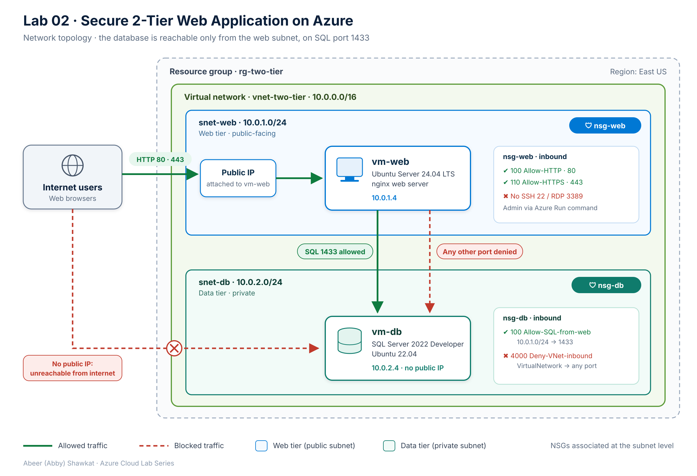
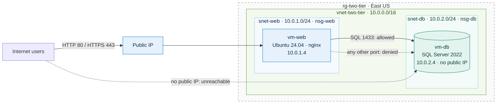

# Lab 02: Building a Secure 2-Tier Web Application on Azure

A two-tier network on Microsoft Azure: a public web tier and a private SQL Server tier, separated by network security groups that allow exactly one path to the data.

**Security goal:** the database is never reachable from the internet, and inside the network only the web subnet can reach it, on port 1433 only.

## 📐 Architecture

### Traffic flow and security boundaries
Solid lines are allowed traffic. Dotted lines are blocked.

| Resource | Name | Configuration |
|---|---|---|
| Resource group | `rg-two-tier` | East US |
| Virtual network | `vnet-two-tier` | 10.0.0.0/16 |
| Web subnet | `snet-web` | 10.0.1.0/24, protected by `nsg-web` |
| Data subnet | `snet-db` | 10.0.2.0/24, protected by `nsg-db` |
| Web VM | `vm-web` | Ubuntu Server 24.04 LTS, nginx, public IP, 10.0.1.4 |
| Database VM | `vm-db` | SQL Server 2022 Developer on Ubuntu 22.04, 10.0.2.4, **no public IP** |

## 🔐 Security Design

**nsg-web (inbound)**

| Priority | Rule | Source | Port | Action |
|---|---|---|---|---|
| 100 | Allow-HTTP | Internet | 80 | Allow |
| 110 | Allow-HTTPS | Internet | 443 | Allow |

**nsg-db (inbound)**

| Priority | Rule | Source | Port | Action |
|---|---|---|---|---|
| 100 | Allow-SQL-from-web | 10.0.1.0/24 | 1433 | Allow |
| 4000 | Deny-VNet-inbound | VirtualNetwork | Any | Deny |

**Key decisions**
- **No admin ports.** Both VMs were configured with Azure Run command, so SSH (22) and RDP (3389) are never opened.
- **Rules on subnets, not VMs.** Every VM placed in a subnet inherits that subnet's rules.
- **Explicit VNet deny.** Azure's default `AllowVnetInBound` rule (priority 65000) lets all traffic inside a VNet through. The deny rule at priority 4000 limits the web tier to SQL only.

## 🛠️ Build Steps
1. Create the resource group `rg-two-tier` in East US
2. Create `vnet-two-tier` with subnets `snet-web` and `snet-db`
3. Create `nsg-web` and `nsg-db` with the rules above
4. Associate each NSG with its subnet
5. Deploy `vm-web` (Ubuntu, public IP, no inbound admin ports)
6. Deploy `vm-db` (SQL Server 2022, no public IP)
7. Install nginx on `vm-web` with Run command
8. Set the SA password and start SQL Server on `vm-db` with Run command
9. Run the validation tests below

## ✅ Validation

| # | Test | Expected | Result |
|---|---|---|---|
| 1 | Browser → `vm-web` on port 80 | Page loads | Pending |
| 2 | `vm-web` → `vm-db` on port 1433 | OPEN | Pending |
| 3 | `vm-web` → `vm-db` on port 22 | BLOCKED | Pending |
| 4 | Internet → `vm-db` on port 1433 (IP flow verify) | Access denied | Pending |
